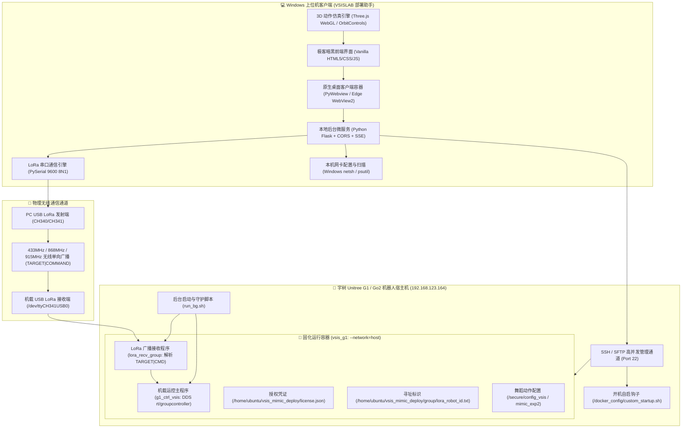

# VSISLAB 机器人部署与群控助手 (Robot Deployment & Fleet Control Assistant)

<div align="center">


-blue?style=flat-square)


<p align="center">
  <b>面向宇树 Unitree G1 / Go2 机器人的商业化一键部署、硬件环境深度预检、Docker 固化容器管理、开机自启守护、64位硬件机器码与 License 授权校验、LoRa 广播串口群控与多机编队调度、3D WebGL 动捕仿真及实时日志诊断系统。</b>
</p>

</div>

---

## 📖 目录

- [🌟 系统核心特性](#-系统核心特性)
- [🏗️ 技术架构与栈选型](#️-技术架构与栈选型)
- [🚀 快速开始与运行开发](#-快速开始与运行开发)
  - [1. 源码运行环境准备](#1-源码运行环境准备)
  - [2. 本地启动与调试](#2-本地启动与调试)
  - [3. 一键编译打包为独立单文件 EXE](#3-一键编译打包为独立单文件-exe)
- [🧩 系统功能模块详述](#-系统功能模块详述)
  - [1. 🚀 一键自动化部署向导](#1--一键自动化部署向导)
  - [2. 🎯 机器人群控与多机编队调度台](#2--机器人群控与多机编队调度台)
  - [3. 💃 舞蹈动作工程热更新](#3--舞蹈动作工程热更新)
  - [4. 🕺 3D 舞蹈预览与骨骼动作仿真库](#4--3d-舞蹈预览与骨骼动作仿真库)
  - [5. 🛠️ 宿主机环境预检与一键自愈修复](#5-️-宿主机环境预检与一键自愈修复)
  - [6. 📦 镜像管理、容器固化与自启守护](#6--镜像管理容器固化与自启守护)
  - [7. 🔑 64 位硬件机器码与 License 授权管理](#7--64-位硬件机器码与-license-授权管理)
  - [8. 📋 实时多源日志与智能诊断引擎](#8--实时多源日志与智能诊断引擎)
  - [9. 🌐 Windows 网卡直连配置与断网自愈](#9--windows-网卡直连配置与断网自愈)
  - [10. ⌨️ 远程控制台与手动运维模式](#10-️-远程控制台与手动运维模式)
- [📡 通信协议与群控指令规范](#-通信协议与群控指令规范)
  - [1. 寻址与数据包格式](#1-寻址与数据包格式)
  - [2. 完整群控命令集](#2-完整群控命令集)
  - [3. 动作组与舞蹈别名映射机制](#3-动作组与舞蹈别名映射机制)
  - [4. 优先级仲裁与安全保护机制](#4-优先级仲裁与安全保护机制)
- [🏭 商业化现场标准部署流程](#-商业化现场标准部署流程)
- [📁 源码工程目录结构](#-源码工程目录结构)

---

## 🌟 系统核心特性

1. **全自动化流式部署向导**：
   - 6 步闭环向导（网络探测 ➔ 环境预检 ➔ 镜像导入 ➔ 容器固化 ➔ License 授权 ➔ 动作联调），支持断点引导与进度回显。
   - **智能静默跳步**：软件启动自动执行 `startup_check`，已部署授权的机器人直接进入群控模式，不打扰现场日常运维。

2. **现代化 LoRa 无线群控与多机编队调度**：
   - **智能串口管理**：自动扫描并识别上位机插接的 CH340/CH341 USB 串口发射器，自动握手并单次下发 `ALL|GETDANCELIST` 动态同步机载全部动作列表。
   - **灵活编队寻址**：支持单选（A/B/C/D...）、`Ctrl+左键` 多选任意组合编队、`Ctrl+A` 全选广播（ALL）与自定义 ID 添加。
   - **完备控制台**：涵盖解锁站立 (STAND)、激活步态 (GAIT)、趴下卸力 (PASSIVE)、急停复位 (STOP)、硬停急停 (EMERGENCY)、方向移动 (W/A/S/D/Q/E，5Hz 连续平滑发包) 及分组舞蹈网格平铺。

3. **免编译舞蹈动作包热更新**：
   - 支持拖拽或选择动作文件夹（包含 `.vsis` 模型与 `config.yaml`）或 `.zip` 压缩包，自动解压覆盖至 `/secure/config_vsis` 并自动热重启机载运控与跳舞进程。

4. **双骨骼 WebGL 3D 动作动捕仿真**：
   - 内置 Three.js 50fps 真实物理骨骼渲染器，支持 **通用 21 关节** 与 **宇树 G1 29-DOF 真实机器人 30 刚体连杆拓扑**（基于 `body_pos_w` 矩阵精确映射）。
   - 支持多文件/文件夹 `.npz` 动作数据批量拖拽导入、时间轴拖拽、倍速调节与循环播放。

5. **高可靠环境自愈与守护体系**：
   - 机器人宿主机 CH341 驱动一键编译安装 (`ch341ser_linux`)、自动配置 udev 规则 (0666)、冲突盲文驱动 (`brltty`) 自动清除。
   - 上位机内置 Windows CH341 串口驱动安装包 (`CH341SER.EXE`)，一键免找驱动。
   - 宇树开机自启钩子 `/docker_config/custom_startup.sh` 与双进程守护脚本 `run_bg.sh` 自动固化，防端口/DDS 冲突与多开抢占。

6. **高安全性 64 位机器码与 License 授权**：
   - 基于机载硬件指纹（machine-id + NVMe + MAC + SoC 序列号）SHA-256 生成唯一 64 位机器码，容器重装不变。
   - 支持商业化 Base64 / JSON 授权验签，校验有效期、客户信息与授权动作集。

---

## 🏗️ 技术架构与栈选型



- **后端架构**：`Python 3.10+` + `Flask` + `Paramiko` (SSH/SFTP 大文件流式断点续传/并发执行) + `PyWebview` (原生独立客户端窗口) + `PySerial` (COM 端口通信与动态解析) + `Numpy` (3D 运动学解析) + `Psutil` (网卡与进程守护)
- **前端架构**：原生 `HTML5` + `Vanilla CSS` (极客暗黑玻璃拟态系统) + `Vanilla JS (ES6 模块化单页应用)` + `Three.js r128` (WebGL 50fps 真实骨骼物理仿真)
- **打包分发**：`PyInstaller` (独立单文件绿色 EXE，内置 Web 静态资源与 Windows CH341 驱动)

---

## 🚀 快速开始与运行开发

### 1. 源码运行环境准备

推荐使用 Python 3.10 ~ 3.12 虚拟环境：

```bash
# 1. 创建并激活虚拟环境
python -m venv venv
venv\Scripts\activate

# 2. 安装项目依赖
pip install -r requirements.txt
```

### 2. 本地启动与调试

- **标准启动**：双击运行项目根目录下的 **`run.bat`**，或在命令行中执行：
  ```bash
  python main.py
  ```
  程序将自动启动 Flask 后台并唤起 PyWebview 原生客户端桌面窗口（具备独立任务栏图标）。
- **浏览器热调试**：启动后，可直接在 Chrome / Edge 等浏览器访问：
  ```
  http://127.0.0.1:8088
  ```

### 3. 一键编译打包为独立单文件 EXE

项目提供了高度优化的全自动化构建脚本，可自动转换多分辨率应用图标、打包 Web 静态资源与内置驱动，生成**唯一的独立绿色单文件可执行程序**：

```powershell
# 方式 1: 在 PowerShell 中运行一键打包脚本
.\build.ps1

# 方式 2: 双击运行批处理入口
build.bat

# 方式 3: 直接执行 Python 构建工具
python build_package.py
```

构建成功后，输出文件位于：
👉 **`dist/VSISLAB机器人部署助手.exe`**
- 单文件便携版，无任何外部目录依赖；
- 内置 Windows CH341 串口驱动安装包；
- 目标电脑直接双击即可运行。

---

## 🧩 系统功能模块详述

### 1. 🚀 一键自动化部署向导
- **步骤 1：连接与网络**：配置目标机器人 IP（默认 `192.168.123.164:22`，`unitree` / `123`），支持断网自愈与本机网卡一键直连；
- **步骤 2：环境深度预检**：一键检测 Docker、NVIDIA GPU 驱动、CH341 串口、NVMe 磁盘空间，提供一键安装机器人端/上位机端驱动功能；
- **步骤 3：镜像导入**：支持原生文件浏览或输入路径，多策略执行 `docker load`，自动适配 GZIP/TAR/Containerd 镜像格式；
- **步骤 4：启动与自启固化**：启动 `vsis_g1` 容器并自动将自启动钩子写入 `/docker_config/custom_startup.sh`，分配唯一 `Robot ID`；
- **步骤 5：机器码与 License 授权**：毫秒级提取 64 位硬件机器码，导入 `license.json` 自动验签并部署，自动拉起机载运控与通信程序；
- **步骤 6：部署就绪与动作联调**：提供现场 LoRa 快捷动作测试（STAND / GAIT / DANCE / STOP）。

### 2. 🎯 机器人群控与多机编队调度台
- **串口即插即用**：自动检测插接的 USB 串口，优先识别 CH340/CH341 芯片，首次连接自动单次下发 `ALL|GETDANCELIST`；
- **多机编队支持**：
  - 单击单选单机（A/B/C/D...）；
  - `Ctrl + 单击` 自由多选组合编队；
  - `Ctrl + A` 或点击【全选 (ALL)】执行全机队广播；
  - 支持自定义新增受控机器人 ID；
- **运控姿态与动作调度**：
  - 基础姿态：`STAND (1)`、`GAIT (2)`、`PASSIVE (0)`、`STOP (X)`、`EMERGENCY (🚨)`；
  - 运动平移与旋转：`W` (前进)、`S` (后退)、`A` (左移)、`D` (右移)、`Q` (左转)、`E` (右转)，支持按住 5Hz 连续平滑发包；
  - 动作组网格平铺：按 `G1` / `G2` / `G3` 动作组分类展示，支持中文动作名与别名展示，点击即发；
- **TX Terminal 实时日志**：实时监视下发指令包、时间戳与回显。

### 3. 💃 舞蹈动作工程热更新
- 支持直接拖拽或浏览选取 **动作文件夹**（包含 `.vsis` 模型文件与 `config.yaml`）或单个 `.zip` 压缩包；
- 后台自动打包上传、解压并覆盖到机器人 `/secure/config_vsis` 目录；
- 自动执行平滑热重启流程（`pkill -f g1_ctrl_vsis` ➔ `pkill -f lora_recv_group` ➔ `run_bg.sh`），实现**改配置/加动作无需重新编译，秒级热生效**。

### 4. 🕺 3D 舞蹈预览与骨骼动作仿真库
- **双拓扑骨骼兼容**：
  - **21 关节**：通用标准人形骨骼拓扑；
  - **30 刚体连杆**：**Unitree G1 29-DOF 真实机器人**（基于 `body_pos_w` 矩阵映射 28 组刚性骨骼链与头部球体）；
- **交互控制器**：支持 50fps 平滑回放、时间轴拖拽跳转、速度倍率切换（0.5x / 1.0x / 1.5x / 2.0x）、循环模式与视角一键复位；
- **动作导入**：支持拖拽外部 `.npz` 文件直接加入动捕动作库。

### 5. 🛠️ 宿主机环境预检与一键自愈修复
- 覆盖 Docker 运行状态、NVIDIA 容器运行时、GPU 加速架构、CH341 USB 串口节点、磁盘剩余空间（>=15GB 保障）；
- 提供 **一键修复机器人 CH341 驱动**：自动拉取官方源码编译安装 `ch341.ko`、配置 `udev` 规则 (`MODE="0666"`)、卸载冲突的盲文驱动 (`brltty`)；
- 提供 **一键安装 Windows 上位机 CH341 驱动**：一键调起内置安装程序。

### 6. 📦 镜像管理、容器固化与自启守护
- **固化启动参数**：
  ```bash
  docker run -d --restart=on-failure \
    --name vsis_g1 \
    --network=host \
    --shm-size=8192m \
    --privileged \
    --cap-add=SYS_PTRACE \
    --cap-add=NET_ADMIN \
    -v /dev:/dev \
    -v /tmp/.X11-unix:/tmp/.X11-unix:rw \
    -v /tmp:/tmp/ \
    -v /run/udev/:/run/udev/ \
    -v /etc/localtime:/etc/localtime:ro \
    -v /etc/timezone:/etc/timezone:ro \
    rl_cu118:2.0
  ```
- **开机自启固化**：写入宇树自启动钩子 `/docker_config/custom_startup.sh`，宿主机与容器双向同步；
- **机载守护进程**：`run_bg.sh` 自动管理动态库加载、单一实例互斥排他与串口设备热插拔守护。

### 7. 🔑 64 位硬件机器码与 License 授权管理
- **机器码读取**：基于 `machine-id`、NVMe 序列号、MAC 与 SoC 指纹 SHA-256 提取 64 位机器码，优先持久化缓存读取；
- **License 导入与校验**：解析 Base64 / JSON 授权文件，自动校验硬件指纹、有效期、授权舞蹈模块，一键同步部署至 `/home/ubuntu/vsis_mimic_deploy/license.json`。

### 8. 📋 实时多源日志与智能诊断引擎
- 支持实时切换查看 **运行中容器日志 (vsis_g1)**、**LoRa 通信日志 (lora_recv.log)**、**运控主程序日志 (sec_run.log)** 及 **内核硬件日志 (dmesg)**；
- **智能诊断规则引擎**：自动识别驱动缺失、License 不匹配、DDS 通信冲突、CUDA 异常、端口冲突与 Robot ID 错误，并给出对应一键修复操作；
- 提供关键词过滤、自动换行、滚到底部、一键复制、日志文件导出下载与全屏模式。

### 9. 🌐 Windows 网卡直连配置与断网自愈
- 一键调用 Windows `netsh` 将本机有线以太网卡配置为 `192.168.123.200/24`（网关 `192.168.123.1`），支持一键恢复 DHCP；
- **断网自愈常驻守护**：网线热插拔或机器人刚开机时，系统自动识别并完成握手连接；
- 支持全网段并发扫描（`192.168.123.1~254`）快速发现机器人设备。

### 10. ⌨️ 远程控制台与手动运维模式
- 内置常用维护 Bash 指令卡片（一键查询进程、重启容器、查看端口、检查 GPU 等），支持自定义命令交互与 sudo 提权。

---

## 📡 通信协议与群控指令规范

### 1. 寻址与数据包格式

- **物理通信**：LoRa 无线透明传输，波特率 **`9600 8N1`**。
- **数据包格式**：`TARGET|COMMAND\n`（ASCII 编码，`\n` 换行符结尾）。
  - `TARGET`：目标机器人 ID（如 `A` / `B` / `C` / `D`...），或群发广播标识 `ALL`。
  - `COMMAND`：控制动作指令字。

### 2. 完整群控命令集

| 命令字 | 物理手柄映射 | 作用与功能说明 |
|---|---|---|
| `ALL\|STAND` | `L1 + START` | 进入 **FixStand** 固定站立状态 |
| `ALL\|GAIT` | `R1 + START` | 激活 **RL_MJAMP** 运动步态（进入可移动状态） |
| `ALL\|PASSIVE` | `STOP + LEFT` | 回到被动阻尼保护状态（趴下卸力） |
| `ALL\|FORWARD,2` | 摇杆推上 / `W` | 前进持续 2 秒 |
| `ALL\|BACKWARD,2` | 摇杆拉下 / `S` | 后退持续 2 秒 |
| `ALL\|MOVE_LEFT,2` | 摇杆推左 / `A` | 向左横移平移持续 2 秒 |
| `ALL\|MOVE_RIGHT,2` | 摇杆推右 / `D` | 向右横移平移持续 2 秒 |
| `ALL\|TURN_LEFT,1` | 转向推左 / `Q` | 原地左转持续 1 秒 |
| `ALL\|TURN_RIGHT,1` | 转向推右 / `E` | 原地右转持续 1 秒 |
| `ALL\|STOP` | `B 键` | **软停**：运动速度减速归零（保持站立） |
| `ALL\|EMERGENCY` | `L2 + R2 + B` | **硬停急停**：立即零轴输出并取消所有按键控制 |
| `ALL\|DANCE,<ALIAS>` | 组合键映射 | 触发对应别名的舞蹈动作（如 `ALL\|DANCE,G1_TIKTOK`） |
| `ALL\|GETDANCELIST` | - | 向机载端请求返回全部已加载的舞蹈动作列表 YAML |

### 3. 动作组与舞蹈别名映射机制

机载程序通过 `group/lora_recv_group.yaml` 配置 33 支标准动作别名与物理按键组合映射：

```yaml
dance_map:
  # Group 1: select key L1 (共 12 支)
  G1_TIKTOK:       [L1, UP]       # 抖音舞
  G1_TURN_JUMP:    [L1, DOWN]     # 转身跳跃
  G1_FRONT_FLIP:   [L1, RIGHT]    # 前空翻
  ...
  # Group 2: select key R1 (共 10 支)
  G2_WAVE:         [R1, UP]       # 手臂波浪
  ...
  # Group 3: select key L2 (共 11 支)
  G3_BALLET:       [L2, UP]       # 芭蕾旋转
```

- **增减舞蹈动作**：仅需在 `dance_map` 中追加别名与按键映射，重启 `lora_recv_group` 即可生效，无需重新编译 C++ 源码。

### 4. 优先级仲裁与安全保护机制

1. **硬件遥控器绝对优先**：物理无线手柄信号输入时，虚拟 LoRa 手柄主动让位避让；
2. **通信超时保护**：任何通道连续 3 秒无有效输入，机器人自动切回 Passive 状态防止失控；
3. **安全断开保护**：上位机断开串口连接或退出时，自动向全机队广播发送一次 `ALL|STOP`。

---

## 🏭 商业化现场标准部署流程

针对每台宇树 G1 机器人，现场执行一次完整闭环部署：

```
[步骤 1] 机器人上电开机 ➔ 电脑网线直连机器人网口
         ↓
[步骤 2] 打开部署助手 ➔ 点击【断网自愈与自动连接】握手机器人 (192.168.123.164)
         ↓
[步骤 3] 进入【环境预检】➔ 确认 Docker 与 GPU 状态 ➔ 点击【一键修复 CH341 驱动】
         ↓
[步骤 4] 进入【镜像管理】➔ 选取并上传 Docker 镜像包 ➔ 执行【docker load】导入镜像
         ↓
[步骤 5] 分配唯一 Robot ID (如 A, B, C...) ➔ 点击【固化启动 vsis_g1 容器】(自动写入自启钩子)
         ↓
[步骤 6] 进入【机器码与 License】➔ 读取 64 位 Machine ID ➔ 导入并部署 license.json
         ↓
[步骤 7] 启动机载程序 (run_bg.sh) ➔ 日志确认运控与 LoRa 接收正常就绪
         ↓
[步骤 8] 进入【群控控制台】➔ 动作联调：STAND ➔ 等待3秒 ➔ GAIT ➔ DANCE ➔ STOP
```

---

## 📁 源码工程目录结构

```
RobotDeploymentAssistant/
├── backend/                      # 后端核心业务层
│   ├── deployment_core.py        # 容器生命周期、自启动固化、环境预检与修复引擎
│   ├── serial_manager.py         # LoRa 串口通信、CH341识别、群控发包与动作列表解析
│   ├── license_service.py        # 64 位机器码提取、License 验签与远端部署服务
│   ├── dance_updater.py          # 舞蹈动作包解压覆盖 (/secure/config_vsis) 与热重启
│   ├── network_manager.py        # Windows netsh 本机网卡配置、断网自愈与网络扫描
│   ├── log_diagnostics.py        # 实时日志拉取、多容器过滤与智能诊断规则引擎
│   ├── npz_service.py            # 3D 动作 NPZ 数据解析与 21/30 关节拓扑映射
│   ├── ssh_client.py             # SSH/SFTP 连接池、大文件分块流式传输与命令流式执行
│   └── drivers/                  # 内置驱动资源
│       └── CH341SER.EXE          # Windows 本机 CH340/CH341 串口驱动安装程序
├── web/                          # 前端单页 Web 应用资源
│   ├── assets/                   # 应用图标、遥控器图解 (remote_guide.svg) 与 3D 预设
│   ├── css/
│   │   └── style.css             # 统一极客暗黑设计系统与玻璃拟态样式规范
│   ├── js/
│   │   ├── api.js                # 后端 RESTful API 通信层
│   │   ├── robot_control.js      # 群控控制台、多机编队选择与按键控制器
│   │   ├── wizard.js             # 一键部署向导流式交互控制器
│   │   ├── dance_player3d.js     # Three.js 3D 骨骼动捕仿真播放器
│   │   ├── log_viewer.js         # 实时日志查看器与智能诊断面板
│   │   ├── tab_panels.js         # 选项卡视图与容器状态管理
│   │   ├── manual_mode.js        # 远程 Bash 运维控制台交互
│   │   ├── app.js                # 全局生命周期与事件总线
│   │   ├── three.min.js          # WebGL 3D 渲染核心库 (r128)
│   │   └── OrbitControls.js      # 3D 场景轨道相机控制器
│   ├── favicon.ico               # 网页/窗口图标
│   └── index.html                # 主工作台与向导模态页面结构
├── tests/                        # 自动化功能单元测试套件
│   ├── test_all_features.py      # 全功能接口集成测试
│   ├── test_dance_zip_update.py  # 动作包更新与解压测试
│   ├── test_folder_upload.py     # 动作文件夹上传测试
│   ├── test_serial_dance_sync.py # 串口舞蹈列表获取与解析测试
│   └── test_serial_sync_policy.py# 串口单次同步策略测试
├── app.py                        # Flask 服务路由与 SSE 流式事件推送入口
├── main.py                       # PyWebview 原生桌面客户端启动入口 (含 AppUserModelID)
├── build_package.py              # 正式版独立单文件 EXE 自动化构建工具
├── build.ps1                     # PowerShell 原生一键打包脚本
├── build.bat                     # Windows 批处理打包入口
├── run.bat                       # 客户端快速运行入口
├── run_test.bat                  # 单元测试运行入口
├── requirements.txt              # Python 依赖清单
├── 群控商业化补充说明.md          # 宇树商业化运控与群控底层规范参考文档
└── README.md                     # 项目技术规范与使用说明文档
```

---

<div align="center">
  <b>VSISLAB Commercial Suite · All Rights Reserved</b>
</div>
